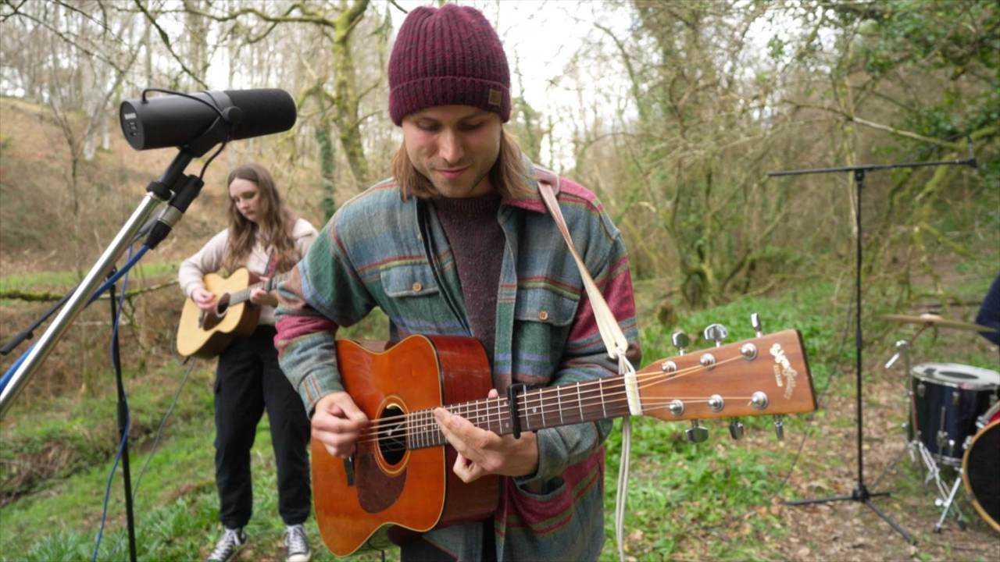
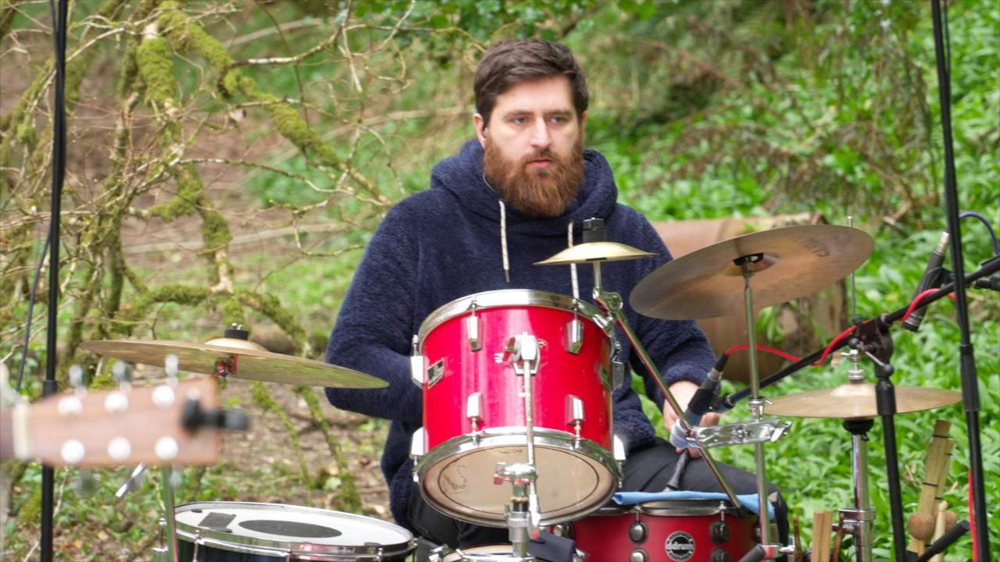
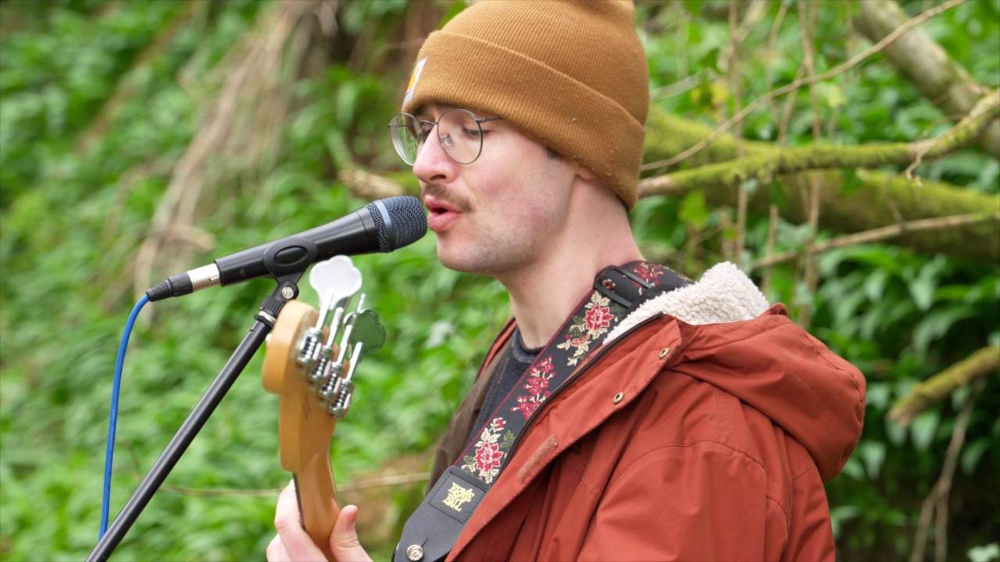

### Luke

Luke Engel (main vocals, harmonies, acoustic guitar, electric guitar, mandolin) - Luke loves being outdoors and you can often find him wandering in wild places looking for cool mushrooms and inspiration for his songwriting.

### Jess

Jess Illingworth (main vocals, harmonies, acoustic guitar, mandolin) - Jess is known by the rest of the band as ‘one take Jess’. She loves walking by the coast and writing lyrics that reach out to people.

### Matt

Matthew Gordon Price (percussion) - Matt, who almost exclusively wears black and a pair of very round sunglasses, loves any excuse to get out the djembe drum.

### Olly

Olly Parker (bass, harmonies) - Olly is the most laid back member of Wild Fenn and enjoys sneaking funky bass lines into the songs.
